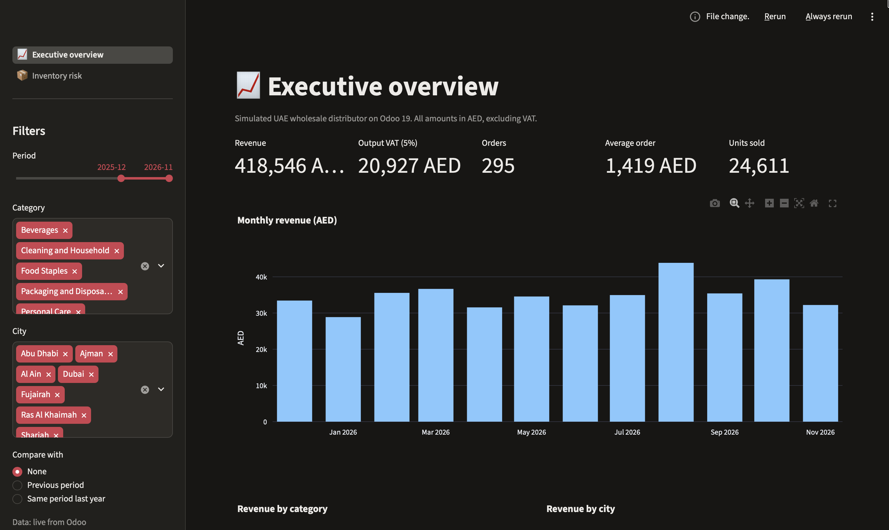
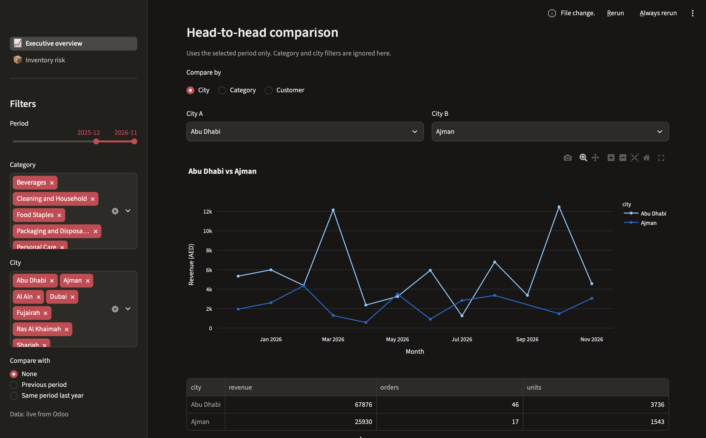
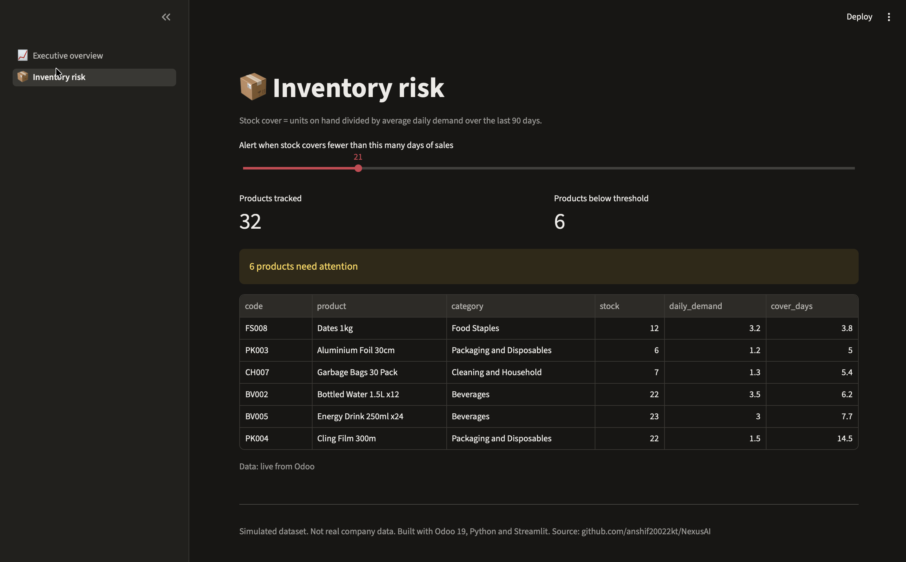

# NexusAI UAE

**Odoo ERP and CRM data turned into a management analytics dashboard for a simulated UAE distribution company, with an AI roadmap.**

**Live demo:** https://nexusai-uae.streamlit.app

> All data in this project is simulated. It is not a real company or client system.





## What it does

- Reads sales, purchasing, stock and CRM data from **Odoo Community 19** (UAE localisation: AED, 5% VAT)
- Multi-page **Streamlit** dashboard with period filters, comparison with the previous period or the same period last year, and head-to-head comparison of cities, categories and customers
- Inventory risk view based on days of stock cover
- **Demo mode:** if Odoo is not reachable, the app reads a saved data snapshot, which is how the public site works

## Project status

| Component | Status |
|---|---|
| Odoo 19 ERP with UAE setup (Docker) | Built |
| Simulated dataset: 837 sales orders, 368 purchase orders, 45 CRM opportunities | Built |
| Multi-page dashboard and public demo | Built |
| Supplier (SRM) and CRM dashboard pages | Next |
| Demand forecasting, stockout and churn models | Planned |
| RAG assistant over UAE VAT and labour documents | Planned |
| Read-only AI agent with audit log | Planned |
| Automated weekly report | Planned |

## Dataset (simulated)

- 36 months of sales, December 2023 to November 2026
- 32 products in 5 categories, 20 customers, 8 suppliers
- Summer beverage peaks and a Ramadan effect that moves earlier every year
- Supplier on-time delivery between 60% and 98%
- Generated with fixed random seeds, so results are reproducible

## Architecture

Odoo 19 and PostgreSQL (Docker) -> Python XML-RPC extraction -> pandas -> Streamlit dashboard -> GitHub -> Streamlit Community Cloud

## Run the demo on your computer

```bash
pip install -r requirements.txt
streamlit run dashboard/app.py
```

Without an Odoo connection the app automatically uses the saved snapshot in `data/snapshot`.

## Tech stack

Odoo 19, PostgreSQL 16, Docker Compose, Python 3.12, pandas, Plotly, Streamlit

## Author

Muhammed Anshif KT
https://www.linkedin.com/in/muhammedanshifkt/
